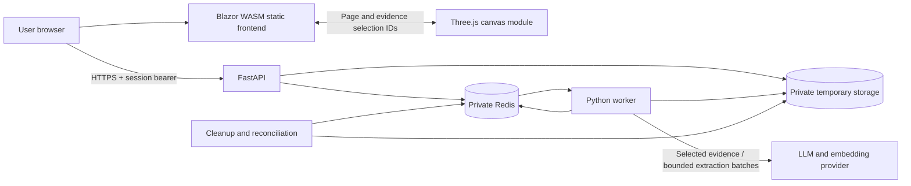

# AIGht System Architecture

Status: proposed MVP architecture, 2 November 2026. Components and directory names below are planned, not an inventory of implemented services.

## Architecture decisions

| Area | MVP decision | Reason |
| --- | --- | --- |
| Browser application | Standalone Blazor WebAssembly and Bootstrap, with a self-hosted Three.js module | Semantic document controls plus the required interactive 3D workspace |
| API | Python / FastAPI | Typed request validation and document/AI integration |
| Background work | One Python worker using RQ with Redis and JSON serialization | Keeps parsing and model calls outside request handlers |
| Temporary state | Redis | Session ownership, operation state, extracted text, bounded retrieval indexes, and scoped caches |
| Original documents | Private temporary object storage; isolated filesystem storage in local development | Keeps large files out of Redis and the public frontend |
| Retrieval | Page-aware chunks, lexical matching plus embeddings, ranked within one document | Grounds answers while preserving evidence locations |
| AI provider | One selected LLM/embedding provider behind a small integration module | Avoids unnecessary provider abstractions; provider selection is still open |
| Persistent database | Deferred; PostgreSQL if accounts/history become necessary | The MVP has no durable user library |
| Hosting | Vercel for static frontend; container-capable host for FastAPI, worker, Redis, and private storage | Separates static delivery from processing lifecycles |

[Microsoft documents standalone Blazor WebAssembly deployment to static hosting](https://learn.microsoft.com/en-us/aspnet/core/blazor/host-and-deploy/webassembly/). The proposed Vercel build must publish those assets with the correct output directory and route fallback; this is a project deployment choice based on [Vercel's build configuration](https://vercel.com/docs/builds/configure-a-build), not a claim that a native Blazor integration is configured.

Use a reproducible build environment with the pinned .NET SDK, or upload prebuilt static output from CI. No ASP.NET server runtime is required by this frontend choice. Keep API/provider secrets in the backend environment; browser-delivered configuration is public.

For lengthy processing, [FastAPI's background-task guidance](https://fastapi.tiangolo.com/tutorial/background-tasks/) points toward an external worker approach. [RQ](https://python-rq.org/docs/) supplies the initial queue; configure its [worker serializer](https://python-rq.org/docs/workers/) consistently as JSON on both producer and consumer. Pin and verify library behavior during scaffolding.

## System boundaries



The browser calls the API directly; document uploads do not pass through a frontend function proxy. Configure explicit frontend origins and HTTPS. The API and worker share application modules but run as separate processes, without introducing a second backend service framework.

Blazor owns the session, selected page/evidence, accessible HTML controls, and Read view. Three.js owns a dedicated canvas/container and its graphics resources. JavaScript keeps the render loop local and sends discrete selection events through interop; Blazor does not receive frame-by-frame callbacks. Both views use the same page/citation IDs from the existing API. Self-host the pinned scene module/assets with the frontend, lazy-load it, and provide the equivalent flat navigator when WebGL or performance is insufficient. No scene-specific backend endpoint is needed; [design.md](design.md) owns the interaction and performance details.

PDF parsing runs in a restricted subprocess/container with no network access and bounded CPU, memory, time, pages, and extracted text. The worker's provider integration has allowlisted outbound access; the parser does not inherit it. Model output cannot invoke tools, fetch URLs, run code, or submit applications.

## Proposed repository layout

```text
/
  AGENTS.md
  ai-declaration.md
  plan.md
  design.md
  architecture.md
  security.md
  api.md
  .github/
    SECURITY.md
    ISSUE_TEMPLATE/
  src/
    AIGht.Web/              # Blazor WebAssembly, Bootstrap, dedicated Three.js module
    aight_api/              # FastAPI routes, schemas, processing modules, worker entry
  tests/
    api/                   # Contract, ownership, lifecycle, and processing checks
    web/                   # Critical UI behavior and accessibility
    fixtures/              # Synthetic or explicitly permitted documents
  evals/                   # Grounding, extraction, abstention, and language evaluations
  infra/                   # Local services and deployment configuration
```

Only the documentation and issue templates are created initially. Add the other directories when they contain useful implementation files.

## Request and processing flow

### Session and ingestion

1. The browser reads public capabilities and the current processing notice. If providers/privacy settings are unconfigured, processing stays disabled.
2. After agreement, the API creates an anonymous session with a 256-bit random bearer token. Redis stores a digest, expiry, limits, and an ownership namespace. The browser holds the token only in memory.
3. Upload validation enforces size and declared type, inspects the PDF signature, and fully stages the input under a server-generated private key with session-expiry metadata. The staged input remains inaccessible until admission commits. Pasted text follows a separate JSON endpoint.
4. Atomically admit the document, operation, idempotency response, counters, and registered RQ job using the admission protocol below. Return `202 Accepted` only after commit; queue arguments contain IDs only.
5. Before parsing, inspect uploads for malware using the selected scan process. Parse in isolation, reject encrypted/malformed files, and inventory every PDF page.
6. Normalize extracted text to NFC and LF line endings. Preserve page boundaries, text spans, reading order, and available bounding boxes; never overwrite the original file.
7. Create chunks with deterministic source mappings. Start around 600 tokens with 80-token overlap, then tune on real layouts. Store every passage's page and offsets rather than trying to reconstruct them after generation.
8. Classify each page as `readable`, `partial`, or `unreadable`. Index usable spans from readable/partial pages within that session/document. Set the document ready with coverage warnings, or fail if no usable text exists.

For mixed scanned/text PDFs, usable spans may be indexed, but every downstream result must retain missing/partial-page warnings. A searchable heading above an image-only body is a partial page, not proof that its requirements were extracted. Inspect text/image placement and extraction quality with the selected parser; classify uncertain body coverage, suspicious text layers, and unreliable table/column order conservatively as partial. Small decorative images alone are not evidence of missing text. Record and evaluate the parser's actual detection rules before beta; OCR remains deferred.

Coverage uses `readable_pages` for all pages with usable text, `partial_pages` as a subset identifying known/suspected gaps, and `unreadable_pages` for pages with no usable text. Every page is in either readable or unreadable, never both. Any partial/unreadable page forces partial coverage. “Complete” means no known extraction gaps, not a guarantee that an OCR text layer or the explanation is correct. Tables and multi-column layouts require dedicated fixtures; do not flatten them into invented relationships.

### Explanation and action extraction

1. Read the whole readable document through bounded, page-aware batches. A top-k question retrieval pass is insufficient for a document-wide checklist.
2. Extract typed facts with source ranges: requirements, eligibility, fees, deadlines, and exceptions.
3. Validate exact citations and schema, deduplicate equivalent facts without dropping distinct conditions, and synthesize the explanation from the evidence-backed facts.
4. Preserve quantities, modality, trigger conditions, and ambiguities. Leave normalized dates/amounts unset when the source does not justify them.
5. Record pages analyzed, partial/unreadable pages, any budget-limited coverage, and validation failures. Cite only usable spans. A partial result identifies omissions and leaves `not_stated` empty; explain that absent facts may be in unreadable or unprocessed content rather than claiming they do not exist.
6. Publish through the guarded finalization protocol below, with the session's remaining lifetime.

### Document questions

1. Authorize the session, document, and readiness before retrieval.
2. Match the question lexically and semantically against that document's chunks; include adjacent context where needed and enforce a context-token budget.
3. Instruct the model to answer from supplied evidence only and return structured claims referring to supplied passage IDs.
4. Map references to canonical source spans on the server. Reject invented passage IDs, out-of-range offsets, and mismatched quotations.
5. Return `answered`, `insufficient_evidence`, or `conflicting_evidence` through guarded finalization. Partial/unreadable pages always propagate partial coverage; if the requested fact cannot be found, say it may be in content the system could not read rather than asserting absence.

Questions are single-turn. Previous answers are not silently treated as new evidence. Source validity is deterministic; whether a claim is supported by a valid quote still needs grounding evaluation and conservative handling.

## Domain records

| Record | Important fields |
| --- | --- |
| Session | ID, token digest, absolute expiry, processing-notice version, counters |
| Document | ID, owning session, generation, input kind, title/filename, state, source key, page counts, coverage, expiry |
| Page | Document ID, one-based index, readability status, canonical usable text, paragraphs, span-to-layout map, warnings |
| Chunk | ID, document ID, text, page spans, embedding, extraction version |
| Operation | ID, owning session/document generation, RQ job ID, attempt token, kind, state, bounded result/error, expiry |
| Citation | Server-resolved document/page/span, exact quote, optional bounding boxes |
| Analysis | Explanation sections, facts, suggested steps, evidence, coverage, generation versions |

Documents are immutable after import. A replacement upload receives a new ID. Operations and caches include document identity and extraction, prompt, model, and schema versions. No content cache or embedding index is shared between sessions, even for identical uploads.

An initial per-document index held as bounded Redis data is sufficient to evaluate the MVP. Do not add a separate vector database before measurements justify it. Embeddings are sensitive derived data and follow the source's access and retention rules.

## Operations, retries, and failure handling

- Document states: `queued`, `processing`, `ready`, `failed`. Deleting, deleted, and expired resources become unavailable externally.
- Operation states: `queued`, `running`, `succeeded`, `failed`, `cancelled`. A success can contain an explicitly partial result.
- Require idempotency keys for document creation, analysis, and questions; handle the same key/body atomically to prevent duplicate work.
- Use bounded provider timeouts and retries for transient failures only. Do not retry unsupported files or invent success after budget exhaustion.
- Enforce two outstanding operations per session and document immutable source identity before publishing a result.
- Redis is temporary infrastructure, not guaranteed durable history. If its state is lost, invalidate affected sessions and sweep orphaned files; ask the user to import again.
- Reconcile abandoned operations after worker failure. A processing state must eventually resolve to a safe failure, cancellation, or expiry.
- Queue only registered internal task names and opaque IDs. Never deserialize user-controlled pickle or evaluate uploaded content as task configuration.

### Atomic admission

Use the same private, non-clustered Redis instance for application coordination and RQ. Keep this within the existing API/worker codebase; no new database, broker, or transaction service is required. Clustered Redis would require a separate key-slot/transaction design before adoption.

1. Validate and fingerprint the request; fully stage any source first. Prepare a registered RQ job with a fixed job ID and serialize validated JSON before changing Redis state.
2. Watch the session, relevant document, scoped idempotency key, and quota/budget keys using `WATCH`. Check ownership, expiry, deletion/generation, readiness, and available capacity. An existing matching accepted key returns its recorded response without another admission.
3. In one `MULTI`/`EXEC`, create the document when needed, the operation and accepted response, reserve counters/budget, set absolute expirations, and enqueue that prepared RQ job. RQ supports a caller-owned pipeline through `enqueue_many`; use the pinned library API rather than manually writing its queue format. Watch expiry/deletion guards on the selected Redis version and keep bounded conflict retries.
4. Only a successful commit permits `202`. Losing a concurrent claim must re-read the committed response or return the documented conflict; it must not create another job. A crash before commit leaves no accepted operation or permanent idempotency claim. A crash after commit but before the HTTP response is recovered by replaying the same key.
5. Delete unused staged sources after rejection or a duplicate replay. The independent sweeper handles a process crash before that cleanup. Never enqueue before the referenced source has been fully stored.

Validate key types and prepared writes before commit: Redis transactions isolate their commands but do not roll back commands that encounter execution errors. If Redis returns an uncertain/partial execution outcome, reconcile against the fixed operation/job IDs and return a dependency error rather than inventing acceptance. [Redis transaction semantics](https://redis.io/docs/latest/develop/using-commands/transactions/) and [RQ pipeline support](https://python-rq.org/docs/#bulk-job-enqueueing) are the implementation references; verify the actual pinned versions in Phase 0.

### Guarded finalization and recovery

A document's generation identifies the authorized source lifecycle. Each running operation attempt receives a fresh attempt token through a guarded state change. Retrying or replacing an abandoned attempt invalidates the old token; it does not create a second logical operation.

- Use a short server-side Redis Lua script for result/index publication. In the same atomic operation, check that the session and document still exist and are live, ownership/generation match, the operation is running with the current attempt token, and absolute expiry has not passed. Only then write bounded results/index references, terminal state, and inherited expirations, and release the operation's reserved capacity once. Use Redis server time for the expiry predicate. Ingestion page/chunk references, ready-state changes, and cache publication use the same guards; no content-bearing publication path may bypass them. Prepare large candidate data outside the script and keep its work bounded to checks and publication, without network calls or indexing. [Redis documents atomic script execution](https://redis.io/docs/latest/develop/programmability/eval-intro/).
- Deletion uses an atomic state change in that same coordination store: revoke the document generation or session first and record minimal cleanup/cancellation markers. If finalization wins first, deletion removes its published data; if deletion wins first, finalization is rejected. Missing parent keys always reject a write; workers must never recreate them with a blind `SET`/`HSET`.
- Candidate file/index artifacts are private and tagged with session, document generation, attempt, and absolute expiry. Write any file candidate before publishing its reference; rejection deletes it. Storage is outside the Redis transaction, so the independent sweeper must catch crashes and late object writes even after an earlier deletion pass.
- RQ completion, retries, and failure callbacks must use the same attempt guards; no callback may bypass deletion or release capacity twice. Store content-bearing results only through the application finalizer; RQ return values contain an operation ID or a content-free completion code, not another copy of the answer.
- Reconciliation compares application operation state with RQ jobs/registries after crashes. Requeue recoverable work under the same logical operation with a new guarded attempt, or mark it failed within a configured deadline. It must also reconcile uncertain admission outcomes; do not leave a claimed key or queued operation waiting until session expiry as the only recovery strategy.

This provides one accepted logical operation and guarded publication, not exactly-once execution of external model calls. A worker crash may require another provider call; account for that in retry/spend budgets. Do not automatically retry calls whose billing outcome is uncertain without a bounded policy.

## Expiry and deletion

Sessions expire 60 minutes after creation; every document, result, cache, index, and idempotency entry inherits that same deadline. Activity does not extend it.

Authorization checks absolute expiry on every request. Worker publication and deletion use the atomic guards above; a permission check followed by an independent write is insufficient. Redis TTL is cleanup assistance, not the authorization decision. Deletion first revokes access and marks cancellation, then removes sources and derived data asynchronously. A late worker must discard output and clean up its temporary files.

Use deterministic document storage prefixes, a cleanup manifest, and an independent sweeper so cleanup still works after Redis state loss. Reconcile late writes and orphaned multipart uploads. Target physical removal from application-controlled live storage within 15 minutes after deletion/expiry; alert on breaches rather than treating this target as a guaranteed result during outages.

Set bounded RQ job, result, failure, retry, and registry retention explicitly; do not inherit long library defaults. Disable backups/versioning of ephemeral document data where possible and verify the deployed storage behavior. Provider retention is a separate published limitation; see [security.md](security.md).

## Deployment and observability

- Local development: pinned SDK/runtime, a local API and worker, Redis, and isolated temporary storage. Run the worker in a Linux container/WSL environment on Windows unless the selected pinned queue version has a verified native configuration.
- Production: separate frontend, API, worker, and storage configuration; private Redis/storage networking and service credentials.
- Configure static route fallback, supported asset MIME types, compression, HTTPS, and public API base URL for the Blazor frontend.
- Build/bundle and self-host the pinned Three.js module and licensed scene assets alongside the Blazor output. Keep private page textures in memory and release them on deletion/expiry; include renderer/context-loss checks in release verification.
- Pin dependencies and base images, enforce resource limits, and run with least privilege. Keep development and production credentials separate.
- Monitor aggregate queue delay, failures, provider latency/token usage, citation rejection, partial coverage, and cleanup lag.
- Logs contain request IDs, status codes, durations, error categories, and version identifiers. Exclude source text, prompts, questions, answers, filenames, bearer tokens, and provider payloads.
- Public liveness exposes only status. Restricted readiness checks validate dependencies without leaking keys or infrastructure details.

## Implementation gates

Before real documents are accepted, confirm the host/provider choices, licensing of parser/viewer/3D libraries, actual privacy notice, safe PDF handling, partial-page detection, source navigation, ownership tests, atomic admission/finalization, deletion races, and measured budgets. Beta also requires the Blazor/Three.js integration, synchronized source selection, flat fallback, and renderer cleanup tests. [api.md](api.md) owns the wire contract; [security.md](security.md) owns security and retention requirements; [plan.md](plan.md) owns delivery milestones and release scope. These requirements are not verified protections until the implementation checks pass.
