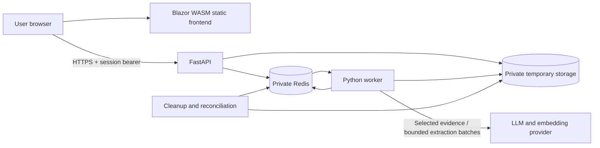

# AIGht System Architecture

Status: proposed MVP architecture, 2 November 2026. Components and directory names below are planned, not an inventory of implemented services.

## Architecture decisions

| Area | MVP decision | Reason |
| --- | --- | --- |
| Browser application | Standalone Blazor WebAssembly and Bootstrap | Fits the proposed stack and can be published as static assets |
| API | Python / FastAPI | Typed request validation and document/AI integration |
| Background work | One Python worker using RQ with Redis and JSON serialization | Keeps parsing and model calls outside request handlers |
| Temporary state | Redis | Session ownership, operation state, extracted text, bounded retrieval indexes, and scoped caches |
| Original documents | Private temporary object storage; isolated filesystem storage in local development | Keeps large files out of Redis and the public frontend |
| Retrieval | Page-aware chunks, lexical matching plus embeddings, ranked within one document | Grounds answers while preserving evidence locations |
| AI provider | One selected LLM/embedding provider behind a small integration module | Avoids unnecessary provider abstractions; provider selection is still open |
| Persistent database | Deferred; PostgreSQL if accounts/history become necessary | The MVP has no durable user library |
| Hosting | Vercel for static frontend; container-capable host for FastAPI, worker, Redis, and private storage | Separates static delivery from processing lifecycles |

[Microsoft documents standalone Blazor WebAssembly deployment to static hosting](https://learn.microsoft.com/en-us/aspnet/core/blazor/host-and-deploy/webassembly/). The proposed Vercel build must publish those assets with the correct output directory and route fallback; this is a project deployment choice based on [Vercel's build configuration](https://vercel.com/docs/builds/configure-a-build), not a claim that a native Blazor integration is configured.

Use a reproducible build environment with the pinned .NET SDK, or upload prebuilt static output from CI. No ASP.NET server runtime is required by this frontend choice. Keep API/provider secrets in the backend environment; browser-delivered configuration is public.

For lengthy processing, [FastAPI's background-task guidance](https://fastapi.tiangolo.com/tutorial/background-tasks/) points toward an external worker approach. [RQ](https://python-rq.org/docs/) supplies the initial queue; configure its [worker serializer](https://python-rq.org/docs/workers/) consistently as JSON on both producer and consumer. Pin and verify library behavior during scaffolding.

## System boundaries



The browser calls the API directly; document uploads do not pass through a frontend function proxy. Configure explicit frontend origins and HTTPS. The API and worker share application modules but run as separate processes, without introducing a second backend service framework.

PDF parsing runs in a restricted subprocess/container with no network access and bounded CPU, memory, time, pages, and extracted text. The worker's provider integration has allowlisted outbound access; the parser does not inherit it. Model output cannot invoke tools, fetch URLs, run code, or submit applications.

## Proposed repository layout

```text
/
  AGENTS.md
  ai-declaration.md
  plan.md
  design.md
  architecture.md
  security.md
  api.md
  .github/
    SECURITY.md
    ISSUE_TEMPLATE/
  src/
    AIGht.Web/              # Blazor WebAssembly and Bootstrap
    aight_api/              # FastAPI routes, schemas, processing modules, worker entry
  tests/
    api/                   # Contract, ownership, lifecycle, and processing checks
    web/                   # Critical UI behavior and accessibility
    fixtures/              # Synthetic or explicitly permitted documents
  evals/                   # Grounding, extraction, abstention, and language evaluations
  infra/                   # Local services and deployment configuration
```

Only the documentation and issue templates are created initially. Add the other directories when they contain useful implementation files.

## Request and processing flow

### Session and ingestion

1. The browser reads public capabilities and the current processing notice. If providers/privacy settings are unconfigured, processing stays disabled.
2. After agreement, the API creates an anonymous session with a 256-bit random bearer token. Redis stores a digest, expiry, limits, and an ownership namespace. The browser holds the token only in memory.
3. Upload validation enforces size and declared type, inspects the PDF signature, and stores the input under a server-generated private key. Pasted text follows a separate JSON endpoint.
4. Create an owned document and ingestion operation; enqueue a registered task with IDs only. Return `202 Accepted` and an operation location.
5. Before parsing, inspect uploads for malware using the selected scan process. Parse in isolation, reject encrypted/malformed files, and inventory every PDF page.
6. Normalize extracted text to NFC and LF line endings. Preserve page boundaries, text spans, reading order, and available bounding boxes; never overwrite the original file.
7. Create chunks with deterministic source mappings. Start around 600 tokens with 80-token overlap, then tune on real layouts. Store every passage's page and offsets rather than trying to reconstruct them after generation.
8. Index readable pages within that session/document. Set the document ready, with explicit unreadable-page warnings, or fail if no usable text exists.

For mixed scanned/text PDFs, the usable pages may be indexed, but every downstream analysis must carry the missing-page warning. Tables and multi-column layouts require dedicated extraction fixtures. Do not flatten them into invented relationships.

### Explanation and action extraction

1. Read the whole readable document through bounded, page-aware batches. A top-k question retrieval pass is insufficient for a document-wide checklist.
2. Extract typed facts with source ranges: requirements, eligibility, fees, deadlines, and exceptions.
3. Validate exact citations and schema, deduplicate equivalent facts without dropping distinct conditions, and synthesize the explanation from the evidence-backed facts.
4. Preserve quantities, modality, trigger conditions, and ambiguities. Leave normalized dates/amounts unset when the source does not justify them.
5. Record pages analyzed, pages unreadable, any budget-limited coverage, and validation failures. A valid partial result must identify its omissions; otherwise fail safely.
6. Store the result in the owned operation with the session's remaining lifetime.

### Document questions

1. Authorize the session, document, and readiness before retrieval.
2. Match the question lexically and semantically against that document's chunks; include adjacent context where needed and enforce a context-token budget.
3. Instruct the model to answer from supplied evidence only and return structured claims referring to supplied passage IDs.
4. Map references to canonical source spans on the server. Reject invented passage IDs, out-of-range offsets, and mismatched quotations.
5. Return `answered`, `insufficient_evidence`, or `conflicting_evidence`. The answer may still be partial when document pages are unreadable.

Questions are single-turn. Previous answers are not silently treated as new evidence. Source validity is deterministic; whether a claim is supported by a valid quote still needs grounding evaluation and conservative handling.

## Domain records

| Record | Important fields |
| --- | --- |
| Session | ID, token digest, absolute expiry, processing-notice version, counters |
| Document | ID, owning session, input kind, title/filename, state, source key, page counts, coverage, expiry |
| Page | Document ID, one-based index, canonical text, paragraphs, span-to-layout map |
| Chunk | ID, document ID, text, page spans, embedding, extraction version |
| Operation | ID, owning session/document, kind, state, bounded result/error, expiry |
| Citation | Server-resolved document/page/span, exact quote, optional bounding boxes |
| Analysis | Explanation sections, facts, suggested steps, evidence, coverage, generation versions |

Documents are immutable after import. A replacement upload receives a new ID. Operations and caches include document identity and extraction, prompt, model, and schema versions. No content cache or embedding index is shared between sessions, even for identical uploads.

An initial per-document index held as bounded Redis data is sufficient to evaluate the MVP. Do not add a separate vector database before measurements justify it. Embeddings are sensitive derived data and follow the source's access and retention rules.

## Operations, retries, and failure handling

- Document states: `queued`, `processing`, `ready`, `failed`. Deleting, deleted, and expired resources become unavailable externally.
- Operation states: `queued`, `running`, `succeeded`, `failed`, `cancelled`. A success can contain an explicitly partial result.
- Require idempotency keys for document creation, analysis, and questions; handle the same key/body atomically to prevent duplicate work.
- Use bounded provider timeouts and retries for transient failures only. Do not retry unsupported files or invent success after budget exhaustion.
- Enforce two outstanding operations per session and document immutable source identity before publishing a result.
- Redis is temporary infrastructure, not guaranteed durable history. If its state is lost, invalidate affected sessions and sweep orphaned files; ask the user to import again.
- Reconcile abandoned operations after worker failure. A processing state must eventually resolve to a safe failure, cancellation, or expiry.
- Queue only registered internal task names and opaque IDs. Never deserialize user-controlled pickle or evaluate uploaded content as task configuration.

## Expiry and deletion

Sessions expire 60 minutes after creation; every document, result, cache, index, and idempotency entry inherits that same deadline. Activity does not extend it.

Authorization checks absolute expiry on every request and again before worker publication. Redis TTL is cleanup assistance, not the authorization decision. Deletion first revokes access and marks cancellation, then removes sources and derived data asynchronously. A late worker must discard output and clean up its temporary files.

Use deterministic document storage prefixes, a cleanup manifest, and an independent sweeper so cleanup still works after Redis state loss. Reconcile late writes and orphaned multipart uploads. Target physical removal from application-controlled live storage within 15 minutes after deletion/expiry; alert on breaches rather than treating this target as a guaranteed result during outages.

Set bounded RQ job, result, failure, retry, and registry retention explicitly; do not inherit long library defaults. Disable backups/versioning of ephemeral document data where possible and verify the deployed storage behavior. Provider retention is a separate published limitation; see [security.md](security.md).

## Deployment and observability

- Local development: pinned SDK/runtime, a local API and worker, Redis, and isolated temporary storage. Run the worker in a Linux container/WSL environment on Windows unless the selected pinned queue version has a verified native configuration.
- Production: separate frontend, API, worker, and storage configuration; private Redis/storage networking and service credentials.
- Configure static route fallback, supported asset MIME types, compression, HTTPS, and public API base URL for the Blazor frontend.
- Pin dependencies and base images, enforce resource limits, and run with least privilege. Keep development and production credentials separate.
- Monitor aggregate queue delay, failures, provider latency/token usage, citation rejection, partial coverage, and cleanup lag.
- Logs contain request IDs, status codes, durations, error categories, and version identifiers. Exclude source text, prompts, questions, answers, filenames, bearer tokens, and provider payloads.
- Public liveness exposes only status. Restricted readiness checks validate dependencies without leaking keys or infrastructure details.

## Implementation gates

Before real documents are accepted, confirm the host/provider choices, licensing of parser/viewer libraries, actual privacy notice, safe PDF handling, source navigation, ownership tests, deletion races, and measured budgets. [api.md](api.md) owns the wire contract; [security.md](security.md) owns security and retention requirements; [plan.md](plan.md) owns release scope.
