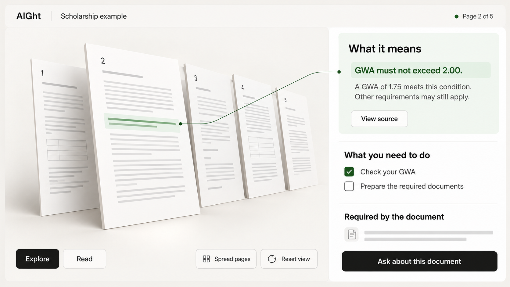

# AIGht Experience and Interface Design

Status: **interactive 3D** direction implemented in the initial v1.0.0 Blazor/Three.js workspace, 3 November 2026. The actual source pages populate an interactive, bounded page stack; Explore, Read, and flat controls share the selected page. This document remains the design acceptance target; physical-device, assistive-technology, and performance validation are still required. Run the workspace from [README.md](README.md). The product scope remains in [plan.md](plan.md).

## Creative direction: Paper to clarity

**AIGht is a warm, minimalist 3D document space.** A document rests as a tactile paper stack in a shallow architectural scene. Users can turn the stack, fan its pages, select a page, and bring the relevant explanation or action into focus. Source citations connect the explanation back to the exact passage.

The central idea: **a complicated document opens into a space people can understand and act on.** The spatial transformation makes the relationship between source, meaning, and next step visible.

Interactive 3D is a defining part of the standard experience on capable devices. Build an actual real-time scene with depth, camera constraints, object picking, and state-linked interactions. A prerecorded video, a static render, or a hover-tilted card alone does not fulfill this direction.

The scene should feel like carefully arranged paper in a quiet reading room: warm white surfaces, charcoal typography, matte materials, restrained green highlights, and generous space. Use a shallow tabletop or recessed architectural plane, soft directional light, and legible silhouettes. Every object represents a document page, an evidence relationship, or an available action.

Keep the surrounding interface precise and flat. Reading text, questions, checkboxes, warnings, and primary controls remain upright HTML. The spatial overview and the reading view share one selection model, so a user can explore in depth and read without perspective distortion.

### Direction and skill synthesis

| Skill | Application to AIGht |
| --- | --- |
| UI/UX Pro Max | Spatial interaction guidance, responsive behavior, accessible drag alternatives, and renderer lifecycle checks |
| Minimalist UI | Warm monochrome surfaces, restrained accents, matte paper, flat controls, and minimal chrome |
| Emil Design Engineering | Purposeful motion, immediate repeated actions, interruptible gestures, and spatial continuity |
| Better UI | Consistent surfaces/radii, explicit interaction states, exact press feedback, and restrained transitions |
| Better Typography | Selectable DOM text, semantic type roles, readable measures, deliberate wrapping, and stable numbers |
| Design Taste Frontend | Product-specific composition and a framed-sheet workspace; no stock dashboard or ornamental card grid |
| Imagegen Frontend Web | Focused horizontal visual references, a consistent palette/material system, and clear implementation cues |
| GPT Taste | A strong opening scene, varied composition, short headlines, and a deliberate explanatory motion sequence |

The product-specific direction resolves conflicting defaults: use real 3D geometry within the scene and opaque, flat interface surfaces around it. Glassmorphism, neon, gradient backgrounds, fake metrics, partner marquees, and mandatory cinematic scroll sequences do not belong in this document task. Keep document actions immediately available throughout.

Design Taste's app-style draw used seed `20261102` and offered `achromatic-ledger` and `framed-sheet`. Choose **framed-sheet** because its paper/work-surface distinction carries this document experience. Keep the tinted outer frame and inset white work surface; replace generic builder nodes with AIGht's document pages and evidence relationships. No redraw was needed. The UI/UX Pro Max search matched a spatial interaction pattern; retain its depth and fallback guidance while replacing its generic glass, Inter font, and delayed CTA defaults with this brief's materials, type, and immediate upload action.

## The 3D space

### Scene composition

Use a bounded, shallow scene rather than a navigable virtual building. A near-orthographic camera gives paper objects physical depth without making page sizes or controls misleading. The main document sits slightly off-center, balanced by the explanation area. Leave a clear safe area for headings and actions; paper never overlaps essential copy.

| Layer | Representation | Meaning |
| --- | --- | --- |
| Ground | Matte warm-white work plane and a shallow rear plane | A stable place to work |
| Source | A stack of thin paper meshes with real page thumbnails | The active uploaded document, in original page order |
| Selection | One page lifted slightly forward | The page currently selected, with an explicit page label |
| Evidence | A restrained green passage mark and a short connection to its explanation | A server-validated source relationship |
| Action | A paper slip associated with a stated requirement or suggested step | A next step, labeled by its actual kind |

Depth encodes selection and source relationships, never certainty, urgency, legal validity, or eligibility. Use text labels for those meanings. Render only the selected page and nearby pages; indicate the actual total with a readable page control rather than instantiating all 50 pages at once.

Paper uses visible thin edges, a matte finish, and at most a faint contact shadow. Avoid glass, mirror reflections, metallic document objects, glowing connectors, particle clouds, floating spheres, office props, and avatars. The single distinctive moment is a highlighted passage opening into its plain-language explanation while its source position stays identifiable.

### Interactive behavior

| Interaction | Spatial response | Equivalent control |
| --- | --- | --- |
| Inspect the stack | Bounded rotation follows a deliberate pointer drag | Labeled “Turn left,” “Turn right,” and “Reset view” buttons |
| Browse pages | Pages fan apart while retaining source order | “Spread pages” / “Stack pages” button |
| Select a page | Picked page moves to the front and becomes the active source page | Page list, page-number input, and previous/next buttons |
| Read a page | Selected page settles into an upright reading view | “Read page” button; direct access to the same source text |
| Select a citation | Its page becomes active; the exact passage opens in reading view | The same labeled citation button in the answer |
| Inspect a requirement | Associated source page and explanation receive a static selection cue | Select the requirement in the DOM list |
| Mark a checklist item | Checkbox, label, and progress update immediately | Native labeled checkbox; no scene manipulation required |
| Return to overview | Current page returns to its place in the stack | “Document overview” button preserving page and reading position |

Use click/tap selection and raycasting for the scene, with semantic HTML controls synchronized to the same state. The 3D fan is a page navigator, not a page-reordering tool. Page order is immutable. Do not introduce cross-document retrieval or comparison through the visual arrangement.

Camera movement is tightly constrained: start with a modest three-quarter angle, allow approximately 12 degrees of horizontal rotation either way and 6 degrees of pitch adjustment, and prevent inversion, free-flight, or zooming through pages. Treat these as prototype starting values to tune on devices. Provide reset at all times. No auto-orbit or device-orientation motion.

### Signature explanatory sequence

Use the synthetic scholarship example to demonstrate one complete relationship:

1. A compact document stack is visible at rest.
2. Selecting “See an example” spreads the pages and exposes the GWA clause.
3. The selected passage receives a stable highlight.
4. A plain-language explanation appears in the adjacent DOM panel: “A GWA of 1.75 meets this condition. Other requirements may still apply.”
5. “View source” opens the exact passage, while “Upload a PDF” remains available.

The sequence is user-triggered, interruptible, and brief. It does not imply that the model analyzed an uploaded document before processing completed. No feature waits for the sequence to finish. Reduced motion shows the selected page and explanation at rest.

## Audience and design intent

The primary visitor is trying to understand an important document, often with limited time, unfamiliar terminology, or a small screen. The workspace combines **Operate** mode for completing tasks with **Read** mode for understanding evidence. Make the next useful action and its supporting passage easy to find.

The product should feel approachable, calm, and precise. Keep the “AIght” feature names, and pair them with descriptive labels so first-time users do not have to learn the brand vocabulary. Spatial exploration should help users locate evidence and understand relationships; the quality of the reading and action flow remains the measure of success.

## Core journey

1. Read a short explanation of what AIGht does and how the document will be processed.
2. Agree to the current processing notice and start a temporary session.
3. Upload a text-based PDF or paste text.
4. See extraction progress and any partial/unreadable-page warning.
5. Explore the page stack, then read the explanation and action checklist beside the selected source.
6. Ask a question and open the passages supporting the answer.
7. Delete the document or end the session.

Do not require account creation for the MVP. Display expiry in the workspace, and explain that refreshing or closing the tab loses the in-memory access token. Server-side copies remain subject to expiry/cleanup even when a tab closes unexpectedly.

## Screens and information hierarchy

### Start and input

- Use a short opening headline such as “Make documents clear.” Support it with “Making complicated documents easier to understand.” Keep the heading within two lines at ordinary supported viewport/text sizes, while allowing accessible text enlargement to reflow naturally.
- Compose the opening around one wide 3D paper scene beneath the headline, with copy and controls in a stable DOM area. Avoid a routine text-left/image-right split.
- Use a plain navigation bar with the AIGht wordmark, “How it works,” and privacy/help links. Keep the primary input action visible above the fold.
- Use “Upload a PDF” as the primary action and “Paste text” as a visually secondary, equally accessible alternative. Do not require interaction with the scene to reach either input.
- State the 10 MiB / 50-page PDF limits, pasted-text limit, and lack of OCR before submission.
- Link to the actual processing notice, provider details, session expiry, and deletion explanation before asking for agreement.
- Use an explicit file picker alongside drag-and-drop. Show the selected filename as text, never as HTML.
- Offer a clearly labeled synthetic scholarship example; do not imply it is an actual scholarship or application opportunity.
- Label English output directly. Do not display enabled language choices that the product does not support.

If a longer introduction is built, its narrative moves from the document scene to a worked source/explanation example, then practical actions, then the upload invitation. Vary composition across those sections. Use actual synthetic examples as proof; do not invent testimonials, logos, prices, or accuracy statistics. Keep normal scrolling and a visible route to upload.

### Document workspace

Desktop: a compact header identifies AIGht, the active document, and remaining session time. Place the work inside a white sheet inset from a warm neutral frame. A two-column workspace places the document area on the left and explanation/actions on the right. Within the document area, **Explore** opens the interactive 3D overview and **Read** opens the upright PDF/text viewer. The selected page and evidence remain synchronized across both views. Keep question entry close to the explanation, with prior session exchanges below it. The active document governs every question.

Explore is the standard ready-state overview on capable desktop devices; Read is always one action away. Selecting a citation enters Read directly. While selecting text, typing a question, or reviewing a checklist, the scene stays still. Switching views preserves the page, selected passage, answer position, and in-memory checklist state.

At 1440 CSS pixels, begin with 24px equal outer gutters and a 24px pane gap: `1440 - 48 - 24 = 1368px` of pane width, split approximately 60/40 (`820.8 + 547.2`). Adjust the ratio only when the reading measure or viewer requires it. Below the width where both panes remain usable, switch to one pane rather than shrinking text. The overview must not push every explanation and action below the first screen.

Small screens: show one content pane at a time, with “Explanation” and “Source” controls. Opening a citation moves to the source pane and provides “Back to answer.” Keep the question control reachable without covering content or the on-screen keyboard. Show a compact scene preview with “Explore in 3D” to load/activate the bounded scene deliberately. Tap page selection and spread/reset controls remain available; vertical page scrolling and browser zoom retain their normal behavior.

Provide a PDF preview through a maintained viewer and an accessible extracted-text view. A PDF canvas alone is insufficient. For pasted text, use the same source view, labeled “Pasted text,” with paragraph navigation; do not imply a physical PDF page exists.

### Explanation structure

| Section | User question | Content |
| --- | --- | --- |
| What it means | What does the document say? | A concise summary followed by important conditions |
| How it may affect you | Which rules might matter to me? | Conditional explanations without collecting a personal profile |
| What you need to do | What should I check or prepare? | Requirements and suggested steps, clearly distinguished |
| Details to check | What needs attention? | Relative deadlines, exceptions, ambiguous terms, and conflicting passages |

Requirements, eligibility, fees, and deadlines must remain individually inspectable. “Not stated” is available only after complete analysis coverage, and refers to the analyzed document rather than rules that might exist elsewhere. With partial/unreadable/unprocessed content, explain what could not be established instead of asserting absence; `not_stated` stays empty in the API result.

### Checklist behavior

- Prefix stated obligations with “Required by the document” and recommendations with “Suggested next step.”
- Each extracted obligation opens its evidence. A suggestion cites its rationale when it depends on a document rule.
- Show explicit dates as written, with normalized dates only when unambiguous. Show relative deadlines with their trigger and counting rule.
- A checked item means “I marked this done.” It does not mean AIGht verified a submission or eligibility.
- Keep checks in browser memory; explain that they reset on reload and are not submitted anywhere.

## Citations and trust

- Use a readable control such as “Source: PDF page 2” or “Source: pasted text, paragraph 3.”
- Selecting it opens the exact passage and announces the source location to assistive technology.
- Distinguish PDF page position from a printed page label. Never substitute the printed label for the actual page index.
- If PDF coordinates are unavailable, highlight the exact passage in the extracted-text view rather than guessing a visual location.
- A mesh pick resolves to a page or validated evidence ID; it never invents a citation from a screen position. In Explore, show a static selection mark on the correct page. Read supplies the exact quotation and selectable passage.
- Display quotations separately from AI explanations. Never style generated prose as if it were original text.
- Preserve focus and a return path when navigating to a citation.
- Display the AI disclosure near results and keep the original source available.
- Describe the actual parsing/coverage problem instead of showing a numeric “confidence” badge without calibration.

## AIght, Ask!

The question input should say “Ask about this document.” Suggested questions include “Which documents must I submit?” and “What does this deadline depend on?”

An answer contains its status, a short explanation, and source controls. Supported statuses are answered, insufficient evidence, and conflicting evidence. Independent questions do not inherit conversation context; use helper copy such as “Name the rule or requirement in each question.”

For insufficient evidence: “I couldn't find this in the readable document. Check with the issuing office.” For conflicting evidence, show both rules before suggesting clarification. Do not replace a missing answer with general model knowledge.

When coverage is incomplete, be more specific: “I couldn't establish the deadline. Part of page 2 could not be read, and the deadline may be there.” A page with a searchable heading over a scanned body is labeled “Page 2 · Partially readable” in Explore, Read, and the flat navigator. Its original thumbnail may still be visible; that does not mean the AI read the image-only text. Keep the warning alongside every affected answer and checklist, not only on the upload screen.

## States and recovery

| State | Interface behavior |
| --- | --- |
| Empty | Show upload/paste choices and a synthetic example |
| Uploading | Show actual byte progress when available and an abort action |
| Queued | Say “Waiting to process”; show no fabricated percentage or completion estimate |
| Extracting / indexing | Show the named stage and allow document deletion to stop work |
| Analyzing | Keep the source usable; announce progress without repeated interruptions |
| Ready | Show results, citation controls, and question entry |
| Partially readable | List partial and unreadable pages, identify known gaps, and label results partial in every affected view; a readable heading never hides an image-only body warning |
| No usable text | Explain that OCR is unavailable and suggest pasting readable text |
| Unsupported/encrypted/oversized input | State the exact restriction and preserve pasted input for correction |
| AI provider unavailable | Keep the source accessible; offer an explicit retry without duplicate work |
| Session quota reached | Explain which limit was reached and when it resets |
| Expired | Remove the displayed private content and explain how to start a new session |
| Deleting | Disable further work immediately; explain that application storage cleanup is asynchronous |
| Offline | Explain that the service is unavailable; do not queue sensitive requests in persistent browser storage |
| Loading 3D assets | Reserve the scene's space and keep input, source access, and explanation controls usable |
| WebGL unavailable or context lost | Replace the scene with the equivalent flat page navigator and preserve selection, answers, and checklist marks |
| Sustained slow rendering | Reduce scene quality, then offer or select the flat navigator without losing document state |
| Reduced motion | Show a stable page arrangement; selection and source navigation work without camera travel or page-flight effects |

A partial result must never look identical to a complete result. Unsupported files must not get an empty “successful” analysis.

## Visual system and materials

Use warm paper backgrounds, charcoal text, near-black primary actions, and one muted green for selected evidence. Keep chromatic accents scarce and meaningful. The scene carries physical depth; the surrounding interface uses opaque surfaces and small tone changes. Avoid decorative gradients, translucent panels, oversized pills, and grids of identical feature cards.

| Token | Value | Use |
| --- | --- | --- |
| Canvas | `#F7F6F3` | Warm outer frame and scene background |
| Surface | `#FFFFFF` | Source and result panes |
| Paper edge | `#E8E5DF` | Thin mesh edges and restrained material separation |
| Primary text | `#232522` | Body and headings |
| Secondary text | `#5C615B` | Supporting labels and metadata |
| Primary action | `#232522`, white text | Flat buttons; hover fill `#363A35` |
| Evidence | `#346538` on `#EDF3EC` | Source selection, with a label and visible outline |
| Structural border | `#EAEAEA` | Subtle panel grouping; never the sole boundary of an input |
| Control boundary | `#777C75` | Input edges and important control outlines |
| Focus | `#165B43` | 2px visible outline, 2px offset from the control |
| Attention | `#7A3E00` on `#FBF3DB` | Warnings with text labels |
| Error | `#9F2F2D` on `#FDEBEC` | Errors with recovery actions |
| Spacing | 4, 8, 12, 16, 24, 32, 48 px | Consistent rhythm |
| Radius | 6px controls, 8px inner surfaces, 12px panels | Restrained interface geometry |
| Outer work sheet | 16px radius around an 8px-radius inner surface with an 8px inset | One consistent nested frame |
| Page mesh | Almost square corners with visible paper thickness | Recognizable document material |
| Contact shadow | Neutral black, opacity at most 0.04 as an initial art target | Grounding inside the scene only; verify under actual lighting |

Use CSS custom properties for interface tokens and map the scene's materials to the same palette. Neutral lighting gradients produced by the 3D renderer are physical shading, not decorative gradient backgrounds. Resting interface panels have no drop shadow; genuine popovers may use restrained elevation. Keep structural borders for inputs, selected states, and useful grouping. Under forced colors, preserve meaningful boundaries and focus without relying on shadows.

Use one Phosphor SVG family in a consistent regular/bold treatment matched to text weight, with `currentColor`; reserve fill for an actual selected state. Pair unfamiliar actions with visible words. No emoji or repeated icons in tinted boxes. Pinned assets and licenses are recorded in `src/AIGht.Web/wwwroot/vendor/manifest.json`.

## Typography

Use the self-hosted **Geist Sans** assets for controls, document explanations, and metadata, with **Instrument Serif** only for the short introductory display headline. The workspace uses the sans-serif alone. Load only the actual weights used, with system/Georgia fallbacks; private document screens do not request third-party fonts. WOFF2 files and OFL licenses are committed with the frontend assets.

| Role | Size | Weight | Unitless line height |
| --- | --- | --- | --- |
| Intro display | `clamp(2.5rem, 5vw, 4.5rem)` | Serif 400 | 1.1 |
| Workspace h1 | `1.5rem` | Sans 600 | 1.25 |
| Section h2 | `1.25rem` | Sans 600 | 1.3 |
| Subsection h3 | `1.0625rem` | Sans 600 | 1.4 |
| Reading text and inputs | `1rem` | Sans 400 | 1.6 |
| Labels and metadata | `0.875rem` | Sans 400–500 | 1.5 |

Cap explanations at approximately `65ch`, within a 60–75-character reading measure. Keep heading levels visually descending. Use `text-wrap: balance` on short headings and `text-wrap: pretty` on prose; retain complete reflow at larger text sizes. Body tracking stays at `0`; headings at 24px and above may use `-0.02em`. Keep text start-aligned, selectable, and rendered as HTML rather than baked into scene textures.

Timers, page counters, structured fees, and numeric columns use `font-variant-numeric: tabular-nums`. Body text and inputs begin at 16px-equivalent sizing, including on phones. A truncated filename has a focus/tap-accessible route to its full value. Long requirements wrap without clamping away conditions. Set language/direction metadata correctly and isolate mixed-direction filenames/identifiers where necessary.

## Motion and interaction polish

Motion explains source relationships and acknowledges deliberate actions. Frequently repeated actions, text input, page-number changes, checkbox checks, and keyboard-initiated navigation update immediately. Visible labels, selected states, and progress messages carry meaning even when motion is disabled.

| Moment | Initial motion specification | Purpose |
| --- | --- | --- |
| Pointer/touch button press | Scale to `0.96` over 150ms, `ease-out`; no scale for disabled controls or keyboard activation | Acknowledge press without changing layout |
| Fine-pointer page hover | Lift the paper edge slightly over 120ms; no camera movement | Identify an available selection |
| Deliberate page selection | 220ms position/rotation settle, `cubic-bezier(0.2, 0, 0, 1)` | Keep the selected page's origin understandable |
| Spread / stack pages | 280ms coordinated separation, same curve; preserve page order | Expose navigable pages |
| Enter Read | Up to 240ms for the optional spatial settle, while the readable DOM view becomes usable immediately | Connect overview and reading |
| Return to overview | At most 180ms, with current selection retained | Restore context quickly |
| Intro demonstration | One user-triggered sequence, approximately 900ms total; up to three groups 100ms apart | Explain source → meaning → action |
| Tooltip/popover | 150ms opacity/limited scale, anchored to its trigger | Reveal contextual help |

Use interruptible transitions or a critically damped spring with no bounce. Rapid selections cancel/retarget the previous movement and settle on the latest state; completion events never control correctness. Drag tracks the pointer responsively and settles without elastic overshoot. Capture the active pointer, ignore extra pointers during that drag, and release capture on completion/cancellation. Do not turn a drag release into an accidental page click.

Gate hover effects behind `(hover: hover) and (pointer: fine)`. Gate camera travel, parallax, translation, rotation, scale, and staged reveals behind `prefers-reduced-motion: no-preference`. Reduced motion keeps the stable layout and immediate functional changes, with an optional opacity transition of at most 100ms. A “Use flat view” control is always reachable and remains selected for the current tab session.

Animate only named properties; never `transition: all`. DOM movement uses transform/opacity, with no routine blur of reading text. In WebGL, update bounded object/camera transforms without rebuilding geometry or uploading page textures each frame. Reserve GSAP, if used, for the short scene choreography through its plain JavaScript API; routine controls use CSS/native behavior. No React migration, scroll-jacking, forced horizontal scrolling, or animation delays before upload, answers, or source access.

## 3D implementation and performance contract

Keep Blazor WebAssembly and Bootstrap for the semantic application shell. Use a self-hosted, pinned **Three.js** module through [Blazor JavaScript interop](https://learn.microsoft.com/en-us/aspnet/core/blazor/javascript-interoperability/) for the scene. Three.js's [WebGL renderer](https://threejs.org/docs/pages/WebGLRenderer.html) uses WebGL 2, so check that capability and handle context loss. This is the recommended frontend implementation, not an installed integration.

- Blazor owns document/session state and DOM controls. JavaScript owns only the canvas and its dedicated scene container; do not let both systems mutate the same DOM subtree.
- Pass compact state changes and stable page/evidence IDs across interop. Keep the render loop inside JavaScript rather than invoking .NET on every pointer move or frame.
- Mesh selection and the DOM page controls dispatch the same authorized selection action. Use existing [API](api.md) page/citation data; scene coordinates are never evidence or an authorization mechanism.
- Use one renderer at a time, low-poly paper geometry, simple matte materials, and a bounded set of neighboring page thumbnails. Start with at most eight rendered page meshes; virtualize the rest while preserving access to every actual page.
- Render on demand for state changes and only run a display-synchronized animation loop while a gesture/transition is active. Stop rendering when idle, hidden, or offscreen. No endless ambient float.
- Lazy-load the scene module after essential controls are usable. Reserve its dimensions to avoid layout shift; mobile activation is explicit. Do not block the upload form on model, texture, font, or renderer readiness.
- Start with device pixel ratio capped at 1.5 on desktop and 1 on phones, thumbnail textures no larger than 1024px on their long edge, and no bloom, depth-of-field, real-time shadow maps, or expensive post-processing. Tune with measurements rather than treating these values as verified capacity.
- Target 60fps during desktop interaction and at least 30fps on the selected representative phone, with idle rendering stopped. Measure frame time, input responsiveness, memory, and repeated view changes on physical devices. Downgrade resolution/page count first; use the flat navigator if performance remains poor.
- Dispose of geometries, materials, textures, render targets, listeners, observers, object URLs, and interop references on document deletion, expiry, replacement, or component teardown. Clear the canvas immediately when private content becomes unavailable.
- Generate private page thumbnails only from the user's authorized document data in memory. Never send documents to an external 3D editor, image-generation service, analytics recorder, or asset CDN. Do not persist private textures or scene snapshots in browser storage or public caches.

The spatial layer adds frontend behavior without new AI features or backend endpoints. English output, document limits, immutable source pages, session expiry, deletion, grounded Q&A, and all privacy rules remain as specified in [plan.md](plan.md), [api.md](api.md), and [security.md](security.md).

## Accessibility and responsive requirements

Target [WCAG 2.2 AA](https://www.w3.org/TR/WCAG22/). Verify actual rendered components rather than assuming Bootstrap provides compliance automatically.

- Semantic landmarks, ordered heading levels, form labels, and error descriptions.
- Keyboard access to upload, paste, tabs, checklist items, questions, citations, and deletion.
- Every spatial action has semantic DOM controls and an equivalent flat page navigator. Keep the visual canvas out of the accessibility tree when equivalent semantic content is present, avoiding duplicate or meaningless mesh announcements.
- Dragging has a single-pointer non-drag alternative as well as keyboard support, following [WCAG 2.2 dragging guidance](https://www.w3.org/WAI/WCAG22/Understanding/dragging-movements.html). Tap buttons are required; a keyboard shortcut alone is insufficient.
- Visible focus and logical focus order; no traps in the document viewer.
- At least 4.5:1 contrast for normal text and 3:1 for large text and meaningful UI boundaries.
- Design touch controls around 44 by 44 CSS pixels; meet AA target-size and spacing requirements.
- Usable layout at 320 CSS pixels and 400% zoom, with essential document/table scrolling contained locally.
- Polite live-region updates for meaningful processing state changes; avoid announcing every polling response.
- Reduced-motion support. Remove camera travel, auto-parallax, page-flight, and staged reveals. Short opacity transitions may acknowledge state changes; reading content remains still and complete.
- Error states use words and icons, not color alone. A source passage is available as selectable text.

## Content and localization

Use familiar words without discarding technical meaning. Define abbreviations on first use, preserve local terms such as GWA, and retain original names, currencies, dates, and qualifiers in source quotations.

Example: “A GWA of 1.75 meets the stated ‘not exceeding 2.00’ condition. Other requirements may still apply.”

Example: “Submit within 15 calendar days after receiving the notice. Your exact due date depends on when you received it and any other counting rules in the document.”

Filipino and Cebuano output are later features. Their design must preserve untranslated source citations and allow a native speaker to compare the explanation with the original.

## Design verification

### Required prototype checks

- Demonstrate actual 3D object picking, bounded rotation, spread/stack pages, Read transition, source-linked selection, and reset. Verify the scene works beyond a static screenshot or hover tilt.
- Complete upload → explanation → cited question → checklist → deletion with mouse, touch, keyboard, and the flat navigator. No task requires dragging or completion of an animation.
- Review the full journey with a long filename, long requirement, multi-page quote, missing fee, conflicting deadlines, unreadable pages, a searchable heading above an image-only body, suspect text/layout, extraction failure, slow connection, and session expiry. Partial source content must never appear as complete coverage or a definitive absence claim.
- Test 1440px, 768px, 390px, and 320px layouts, text enlargement, 400% zoom, portrait/landscape, reduced motion, and forced colors. Document layout changes needed at each size.
- Verify exact source selection is identical in Explore, Read, and the fallback navigator. Check that readable content and primary actions are never occluded by a page or overlay.
- Disable WebGL, simulate context loss and sustained low frame rate, hide/reopen the tab, and switch documents repeatedly. Preserve functional state and confirm render loops/resources are released.
- Delete or expire a document during a page animation and during thumbnail loading. No late callback may restore private thumbnails, text, or scene objects.
- Measure contrast in the actual rendered controls and scene-adjacent labels. Do not assume the proposed palette or framework is automatically compliant.

For a running prototype, use Design Taste's app inspector at its supported widths, inspect every resulting screenshot, and review motion at normal and slowed playback speed. Review the explanatory introduction separately from the workspace; do not apply marketing motion quotas to repeated reading tasks.

**Current verification boundary:** this document can be checked for consistency and complete interaction requirements. Browser layout, typography, screen-reader behavior, contrast of rendered components, 3D performance, and gesture quality remain **Not verified** until an implementation exists. No rendered-interface approval is claimed.

## Visual reference brief

The focused reference deliverable is **one horizontal image of the interactive 3D workspace**. It illustrates the selected spatial/material direction, not a functioning prototype. If a future landing-page design is generated, create one separate horizontal image per actual page section; do not compress the whole site into a tall collage or reuse this one frame as every section.

Generated with the built-in ImageGen tool using synthetic content. The [exact generation prompt](docs/design/aight-3d-workspace-prompt.md) is saved alongside the image. This frame establishes material, depth, and composition; the simplified page marks and lower-panel placeholder strokes must become real source thumbnails and useful content in implementation. The question action must open the labeled question input described above. It does not establish verified type sizes, contrast, or interaction behavior.

Reference composition: one shallow warm-white document space, a thin page stack fanning diagonally through the left/center, one selected page brought forward, a restrained green source mark, and a flat explanation/checklist pane on the right. Use the synthetic scholarship example, near-black controls, generous reading space, and the palette/type roles above. Show “Explore” / “Read,” page navigation, and reset as plausible controls. Keep real reading text upright and the 3D paper secondary to legibility. No fake statistics, testimonials, brands, or unsupported feature controls.

The written behavior, [API contract](api.md), and product scope govern implementation if an illustrative image invents or simplifies a detail. Only synthetic content may appear in generated design references.
