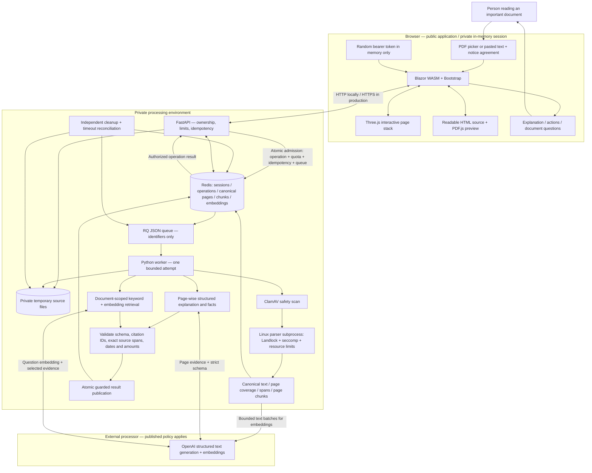
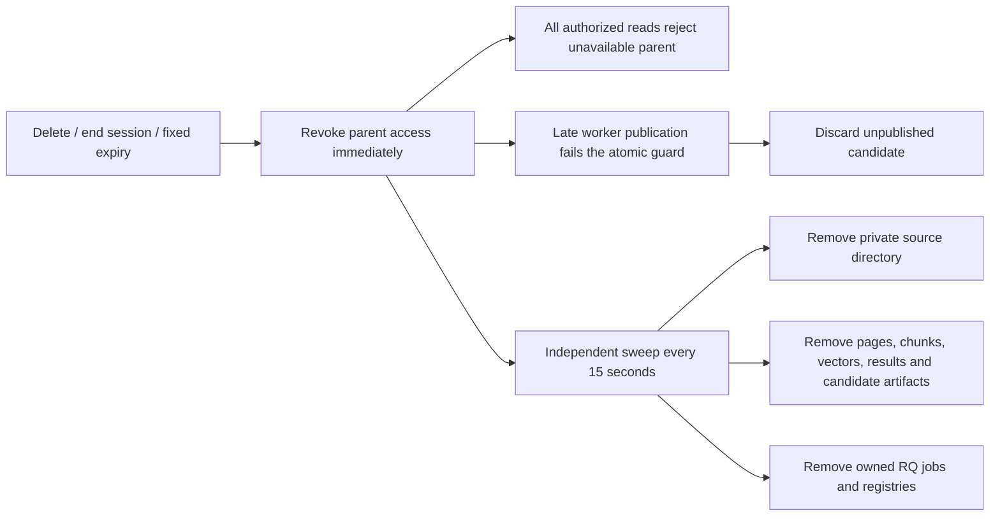

# AIGht 1.0.0: architecture, inputs, and flow

Implemented local system. Deployment and beta verification remain separate gates; see the [README](../../README.md).

## Complete component diagram



The model has no tools, document-following network access, or access to other sessions. The browser never receives the provider key. No PostgreSQL, vector service, account service, or frontend function proxy is required for v1.

## Inputs and outputs

| Input | Route / consumer | Result |
| --- | --- | --- |
| Current notice agreement | `POST /api/v1/sessions` | 256-bit random bearer token and fixed expiry |
| Text-based PDF, ≤10 MiB / 50 pages | `POST /api/v1/documents` | Ingestion operation; scan then isolated extraction |
| Pasted text, ≤100,000 code points | `POST /api/v1/documents/text` | Ingestion operation; one canonical source page |
| English explanation request | `POST …/analyses` | Meaning, possible effects, facts, checklist, citations, warnings |
| Independent question, ≤2,000 code points | `POST …/questions` | Answered / insufficient evidence / conflicting evidence |
| Operation ID + session token | `GET /api/v1/operations/{id}` | Queued / running / succeeded / failed / cancelled |
| Page or citation selection | Blazor ↔ Three.js / source reader | Same page in Explore, Read, and flat navigation |
| Delete document / end session / expiry | API + cleanup process | Immediate access revocation; derived-copy cleanup |

Every accepted import, analysis, and question has an operation ID and requires an idempotency key. The API returns `202`; it does not hold an HTTP request open for AI work.

## Import → understand → ask

```mermaid
sequenceDiagram
    actor User
    participant Web as Blazor browser
    participant API as FastAPI
    participant R as Redis + RQ
    participant W as Worker
    participant P as Parser / scanner
    participant AI as OpenAI
    User->>Web: Review notice; select PDF or paste text
    Web->>API: Create temporary session
    API-->>Web: Token + absolute expiry
    Web->>API: Import + bearer + idempotency key
    API->>API: Validate limits; stage private source
    API->>R: Commit document + operation + reservations + idempotency + queue together
    API-->>Web: 202 operation ID
    W->>R: Claim queued operation with attempt token
    W->>P: Scan PDF; parse in restricted subprocess (text skips PDF parser)
    P-->>W: Pages + canonical text + layout + readable/partial/unreadable
    W->>AI: Bounded embedding batches
    W->>R: Stage candidate; guarded publication checks live parent + generation + attempt + expiry
    Web->>API: Poll operation; fetch pages and authorized source
    API-->>Web: Ready source + coverage warnings
    Web->>API: Queue explanation
    W->>AI: Structured page-wise explanation and extraction
    AI-->>W: Proposed facts with supplied citation IDs
    W->>W: Validate schema + citations + literal dates / amounts
    W->>R: Guarded publication
    API-->>Web: Explanation + next steps + evidence
    User->>Web: Ask a document-specific question
    Web->>API: Queue question
    W->>R: Load only this document's chunks
    W->>AI: Embed question; answer from ranked passages
    W->>W: Validate evidence or return explicit abstention
    W->>R: Guarded publication
    API-->>Web: Answer + source references + coverage
    User->>Web: Select a source reference
    Web->>Web: Select page; open Read; highlight canonical span
```

## Deletion and expiry



All child records inherit the session's absolute expiry. Cleanup independently reconciles files, Redis candidates, operations, and jobs, so a crashed or late worker does not depend on an original file manifest still existing. Provider-side retention follows the deployment's actual published notice. Application-storage cleanup targets 15 minutes; it requires a healthy cleanup process and storage and remains a beta measurement gate.

## Evidence boundaries

Canonical text uses NFC, LF newlines, and Unicode code-point offsets. Citations use half-open `[start,end)` spans; the Blazor reader converts them to UTF-16 indices before highlighting. PDF boxes use normalized page coordinates.

`partial_pages` is a subset of `readable_pages`: a usable heading does not prove its scanned body was read. Partial coverage propagates to explanations and answers, and suppresses `not_stated`. Relative deadlines remain relative. A literal source match does not establish semantic entailment; that requires the reviewed AI evaluation set before beta.
